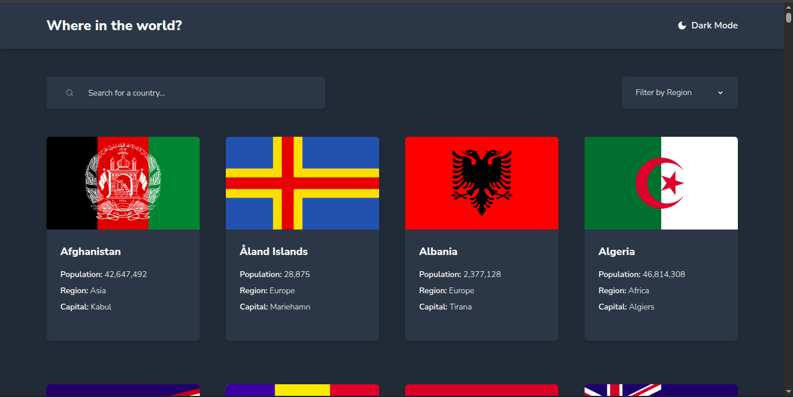

# Countries App

A countries browser with search, region filter, a detail page, and a dark and light theme, built as a solution to a [Frontend Mentor](https://www.frontendmentor.io/challenges/rest-countries-api-with-color-theme-switcher-5cacc469fec04111f7b848ca) challenge. The country data is loaded and cached with TanStack Query.

## Overview

The home page shows a grid of countries with their flag, population, region, and capital. You can search by name and filter by region. Clicking a country opens its detail page, where you can move to a border country or go to the next country in the list. The layout changes between mobile and desktop screen sizes, and every button has a hover state.

## Preview



## Features

- Responsive layout for mobile and desktop screens
- Data fetching with loading and error states using TanStack Query
- Search countries by name
- Filter countries by region, together with the search
- Detail page with native name, population, region, sub region, capital, domain, currencies, and languages
- Border countries as buttons that open the neighbor country
- Next button to move to the next country without going back to the list
- Dark and light theme with a toggle button
- The theme follows your computer setting at first and is saved in the browser
- Handles missing data, like countries with no capital or no borders
- Lazy loading for the flag images
- Custom colors and font set up in the Tailwind theme
- Built with strict TypeScript typing throughout

## Tech Stack

- [React](https://react.dev/)
- [TypeScript](https://www.typescriptlang.org/)
- [TanStack Query](https://tanstack.com/query)
- [Tailwind CSS](https://tailwindcss.com/)
- [Vite](https://vitejs.dev/)

## Getting Started

Clone the repository and install dependencies:

```bash
git clone https://github.com/Zikra-S/REST-Countries-API.git
cd REST-Countries-API
pnpm install
pnpm dev
```

The app will be available at `http://localhost:5173`.

## Data

The countries come from the `data.json` file provided with the challenge, which is in the `public` folder. The flag images are loaded from the internet, so you need a connection to see them.

## Project Structure

```
public/
└── data.json              # Country data from the challenge
src/
├── api/
│   └── countries.ts       # Function that loads the countries
├── components/
│   ├── header.tsx         # Title and theme toggle
│   ├── searchBar.tsx      # Search input
│   ├── regionFilter.tsx   # Region dropdown
│   ├── countryCard.tsx    # Card with flag and basic info
│   └── countryDetail.tsx  # Detail page with border countries
├── hooks/
│   └── useTheme.ts        # Theme state, saved choice, and dark class
├── App.tsx                # Switches between the list and the detail page
├── types.ts               # Country type
├── index.css              # Tailwind import, theme colors, and font
└── main.tsx               # App entry point with the query provider
```